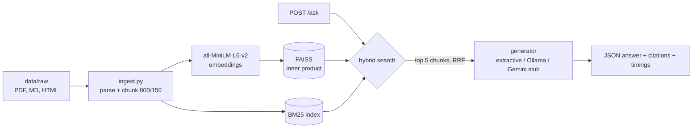

# DeployDesk

A small RAG assistant you can drop onto a client's own documents: ingest their PDFs / Markdown / HTML, ask questions over a REST API, get answers with citations back to the file and page. I built it to practise the forward-deployed side of things: getting something running for a "customer", measuring whether it's actually any good, and handing it over.

Status: work in progress. The API, eval and Docker setup work; written-answer generation with a local LLM is still being tested.

## How it works



Retrieval runs both searches (top 30 each) and merges them with reciprocal rank fusion (k=60). I went with RRF instead of adding normalised scores because BM25 scores and cosine similarities aren't on the same scale and RRF doesn't care.

The generator is pluggable via `generator:` in the config. `extractive` picks the sentences with the most question-word overlap and tags each with `[n]`; no LLM, no cost, works offline. `ollama` sends the chunks to a local model. `gemini` is a stub that needs `GEMINI_API_KEY`. If the LLM call fails for any reason the request falls back to extractive instead of returning a 500, and the response says why in `fallback_reason`.

## Results (demo corpus)

Corpus: 67 public docs (60 FastAPI tutorial/deployment Markdown pages, 5 HTML pages from Uvicorn and Pydantic docs, 2 NIST PDFs: AI RMF 1.0 and CSF 2.0) → 1,461 chunks.

Eval set: 63 questions I wrote by hand, each labelled with the source file and a key phrase. A retrieved chunk counts as correct only if it's from that file *and* contains the phrase (file-only labels were too easy on the 50-page PDFs).

| mode | hit@1 | hit@3 | hit@5 | MRR@10 | citation acc. |
|---|---|---|---|---|---|
| vector only | 0.587 | 0.889 | 0.921 | 0.734 | 0.968 |
| BM25 only | 0.603 | 0.825 | 0.873 | 0.720 | 0.873 |
| hybrid (RRF) | **0.730** | 0.841 | 0.905 | **0.806** | 0.952 |

Hybrid mostly helps the top result (+14 points hit@1, +0.07 MRR over vector-only). It's slightly worse than vector-only at hit@3/hit@5 and citation accuracy on this set, because BM25 pulls in keyword-heavy chunks from the wrong page for vague questions. I kept hybrid as the default since the first result matters most for the answer, but it's a config switch.

"Citation accuracy" = share of questions where at least one cited chunk is from the right file, using the extractive generator.

Latency, 8-core VM, CPU only: retrieval + extractive answer in-process p50 6.5 ms / p95 9.0 ms; full HTTP round trip through uvicorn over 189 requests p50 10.6 ms / p95 16.3 ms. Full ingest of the 67 docs takes ~18 s (mostly embedding).

Reproduce: `python eval/run_eval.py` and, with the server running, `python eval/load_test.py`.

## Running it

Local:

```bash
python -m venv .venv && . .venv/bin/activate
pip install torch --index-url https://download.pytorch.org/whl/cpu
pip install -r requirements.txt
python -m deploydesk.cli ingest
uvicorn deploydesk.api:app --port 8000
```

Then open http://localhost:8000 (chat), /dashboard (counts, eval, live latency) or /docs (OpenAPI).

```bash
curl -s localhost:8000/ask -H "X-API-Key: dev-key-change-me" -H "Content-Type: application/json" \
  -d '{"question": "how do I enable CORS?"}'
```

Docker: `docker compose up -d --build`. Add `--profile llm` to also start an Ollama container.

## Deployment runbook

1. Copy `config/customer.yaml` to e.g. `config/clientname.yaml`, set `customer_name`, `docs_dir`, and point `DEPLOYDESK_CONFIG` at it.
2. Put the client's docs in `docs_dir`. Supported: `.pdf .md .html .htm .txt`.
3. Set `DEPLOYDESK_API_KEYS` (comma-separated) in the environment. Never ship the dev key.
4. `docker compose up -d --build`, then `POST /ingest` once with a key.
5. Check `GET /health` returns `"status": "ok"` and the chunk count looks right.
6. Write 30-50 questions with the client's team, in the same format as `eval/qa.jsonl`, and run `eval/run_eval.py`. If hit@5 is under ~0.8, try a smaller `chunk_size` first, then bge-small as the embedding model.
7. Hand over `docs/HANDOVER.md` filled in with their numbers.

Logs: one JSON line per request in `logs/requests.jsonl` (request id, path, status, latency). `GET /metrics` gives p50/p95 for `/ask` since the process started.

## What didn't work / trade-offs

- Docker isn't available on the VM I built this on, so the Dockerfile and compose file are written but **not built or run yet**. CI builds the image on GitHub.
- Ollama: see notes below, still being tested.
- The extractive answers are accurate but read choppy, and sometimes include markdown link syntax from the source.
- FastAPI's docs pull code samples in with `{* file.py *}` include tags. I drop those tags, so code examples aren't in the index; questions about exact code do worse.
- Re-ingest rebuilds everything. Incremental updates would need per-file chunk ids, which I haven't done.
- The eval set is written by me, from the same docs, so it's probably easier than real user questions. 63 questions is also small; one question is ~1.6 points.

## Tests

`pytest -q` runs 20 tests (chunking, the three file types, API auth, ingest, citations, retrieval modes, logs/metrics, Gemini-stub fallback) against tiny fixtures in `tests/fixtures`, so they don't need the full corpus. CI runs them on every push (`.github/workflows/ci.yml`).

## Data sources

All public: FastAPI docs (MIT), Uvicorn docs (BSD-3), Pydantic docs (MIT), NIST AI 100-1 and NIST CSWP 29 (US government works).
