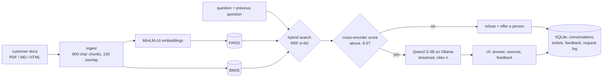

# DeployDesk

DeployDesk is a support help desk that answers from a company's own docs and cites where every sentence came from. When it doesn't know, it hands the question to a person with the context attached. I built it to practise the forward-deployed side of engineering: take a customer problem, get something running inside their environment, measure whether it's any good, and hand it over.

Status: in progress. Everything below runs and the numbers are from my own runs on an 8-core CPU VM with no GPU.

The "customer" is Kestrel Cloud, a made-up hosting company for FastAPI apps. Their brief and the requirements I worked against are in [docs/DISCOVERY.md](docs/DISCOVERY.md). The knowledge base is real public documentation: 60 FastAPI Markdown pages, 5 Uvicorn/Pydantic HTML pages and the two NIST PDFs (AI RMF 1.0, CSF 2.0). That's 67 files and 1,409 passages.

## What it does

- **Ask**: answers stream token by token with `[n]` citations. Clicking a citation opens the source panel with the supporting sentence highlighted. Follow-up questions carry the previous question into retrieval.
- **Refuses instead of guessing**: if the best passage scores too low on the cross-encoder, the LLM isn't called and the user gets "I couldn't find this" plus a button to ask a person.
- **Tickets**: escalating creates a ticket with the question, the bot's answer and its sources. There's a board (open / in progress / waiting / resolved), assignee, priority and internal notes.
- **Knowledge base**: drag in PDF, Markdown or HTML. Files are chunked and embedded on the server and are searchable in well under a second. You can inspect a document's passages and delete it, and the index updates in place.
- **Analytics**: question volume, latency histogram, time to first token, most-cited docs, the questions it couldn't answer, thumbs up/down reasons, and the offline eval results.
- **Settings**: retrieval mode, top-k, guardrail threshold and model, saved back to the customer's YAML.
- REST API (`/ask`, `/ingest`, `/health`, `/metrics`, plus the `/api/*` routes the UI uses), API-key auth, and one JSON log line per request.



Nothing leaves the box: embeddings, reranker and LLM all run locally. That was requirement R3 in the brief. There's a Gemini generator behind the same interface for teams that are allowed to use a cloud model, but I haven't tested it against a real key.

## Results

Retrieval, 63 questions I labelled by hand (`eval/qa.jsonl`). A hit needs the right file *and* the passage has to contain a key phrase, because file-only labels were too easy on 50-page PDFs. From `eval/results.json` and `eval/results_rerank.json`:

| mode | hit@1 | hit@5 | MRR@10 | p50 latency |
|---|---|---|---|---|
| vector only | 0.651 | 0.857 | 0.747 | 4.7 ms |
| BM25 only | 0.603 | 0.889 | 0.727 | 1.1 ms |
| hybrid (default) | 0.651 | **0.921** | 0.764 | 5.7 ms |
| hybrid + cross-encoder rerank | 0.667 | 0.905 | 0.771 | 151 ms |

Hybrid is the default because it finds the right passage in the top 5 most often. Reranking adds ~145 ms for at most one extra hit@1 on this set, so it's off. I still use the cross-encoder, just for the refuse-or-answer check.

Answers, Qwen2.5-3B (Q4_K_M) on Ollama, CPU only (`eval/answer_eval.py` → `eval/results_llm.json`). I restarted Ollama before the run so its prompt cache didn't fake the first-token times:

- 63/63 real questions answered, 10/10 off-topic questions refused (capital of France, Kestrel billing questions the docs don't cover, etc.)
- every answer has at least one citation; 81.7% of sentences carry one
- 42.6% of cited sentences are judged "entailed" by their cited passage by an NLI model (deberta-v3-base). This is a strict check, since paraphrases often come out neutral, and it moved between 39% and 45% across my runs. It's the number I'd most like to push up.
- cites the labelled document 68.3% of the time; the right passage was in the context 88.9% of the time
- first token p50 **2.0 s** / p95 3.5 s, **21.6 tokens/s**, full answer p50 4.4 s (mean 47 tokens)

Through the real server with the browser's endpoint (`eval/replay.py`, 24 new questions in `eval/demo_questions.txt`): first token p50 2.3 s, full answer p50 4.9 s. The two Kestrel billing questions in there were refused, which is what should happen.

Docker (`eval/docker_coldstart.json`): the image is 1.81 GB with CPU-only torch and both small models baked in. From `docker run` to a healthy `/health` took 4.2 to 4.6 s over three runs, and the first answer after that took 3.2 to 6.2 s (the first one pays for loading the models into memory). I ran it with `sudo docker run --network host` against Ollama on the host.

## Running it

Local, with Ollama already running:

```bash
python -m venv .venv && . .venv/bin/activate
pip install torch --index-url https://download.pytorch.org/whl/cpu
pip install -r requirements.txt
ollama pull qwen2.5:3b && export OLLAMA_MODEL=qwen2.5:3b
python -m deploydesk.cli ingest
uvicorn deploydesk.api:app --port 8000
```

Open http://localhost:8000. With `demo_mode: true` the UI picks up the dev key by itself; turn that off for anything real.

Docker compose starts the app and Ollama together:

```bash
export DEPLOYDESK_API_KEYS=<something long>
docker compose up -d --build
docker compose --profile setup run --rm ollama-pull   # first time only
```

## Runbook for a new customer

1. Copy `config/customer.yaml`, set the name, greeting and suggested questions, and point `DEPLOYDESK_CONFIG` at it.
2. Put their docs in `data/raw/` (or upload them from the Knowledge base page later).
3. Set `DEPLOYDESK_API_KEYS`. Never ship the dev key, and set `demo_mode: false`.
4. Bring it up and check `/health` shows the chunk count you expect.
5. Sit with their support team and write 30-50 real questions in the `eval/qa.jsonl` format. Run `eval/run_eval.py`, then `eval/answer_eval.py`. If hit@5 is under ~0.8, try a smaller `chunk_size` first.
6. Check the guardrail on their questions: real questions should score above `min_rerank_score`, off-topic ones below it. I picked -6.5 because on my sets real questions bottomed out at -5.6 and off-topic ones topped out at -7.8.
7. Watch the "Gaps in the docs" panel for the first week. That list is where their docs need work.

Logs go to `logs/requests.jsonl` (request id, path, status, latency, TTFT). The same id is in the `X-Request-ID` header.

## What didn't work, and trade-offs

- **The reranker.** I expected the cross-encoder to be the big win. On the first index it actually hurt hybrid. After I cleaned up the ingest it helped a bit, and on the final index it makes no real difference to hit@5 and costs ~150 ms. So it's off by default.
- **Groundedness is mediocre.** A 3B model on CPU blends sources and paraphrases, and only ~43% of cited sentences pass the strict NLI check. A bigger model would help, but on this box the 7B would put first token at 5+ s. I chose speed. I also tried Qwen 1.5B: it ran at ~35 tok/s but wrote long answers and dropped citations.
- **Small models and citation format.** The model kept writing `[1, 2]` or putting `[1]` after the full stop. Prompting fixed most of it and `normalize_citations` fixes the rest.
- **Ingest cleanup moved every number.** Fixing HTML line breaks, mkdocs anchors, code comments being read as headings, and PDF line wrapping changed the results by a few points each time. The v0.1 numbers I first wrote down (hybrid hit@1 0.73) came from a dirtier index and aren't comparable.
- **Follow-ups are basic.** I prepend the previous question to retrieval and tell the model what it was. That fixed "and how do I set that up in production?" but it isn't real query rewriting.
- **Environment problems.** On my VM apt and the Ollama registry were blocked, so I installed Ollama from the release tarball and built the models from GGUF files on Hugging Face. There's no iptables, so the Docker daemon runs with bridge networking off and I tested the container with `--network host`. Compose itself is written for a normal Docker host, and that path I haven't run end to end.
- **The eval set is mine.** I wrote the questions from the same docs, so they're probably easier than real user questions. One question is ~1.6 points.

## Tests

`pytest -q` runs 30 tests against small fixtures (chunking, the three file types, auth, upload/delete, streaming, tickets, feedback, analytics, settings, citation clean-up, the guardrail). `tests/e2e/ui_flows.py` drives the real UI in headless Chrome through 12 flows: ask, stream, open a citation, thumbs down, follow-up, escalate, off-topic refusal, conversation search, ticket update, upload/inspect/delete, analytics, settings. With `--shots shots` it also saves the screenshots. CI (`.github/workflows/ci.yml`) runs pytest and builds the image.

## Data sources

All public: FastAPI docs (MIT), Uvicorn docs (BSD-3), Pydantic docs (MIT), NIST AI 100-1 and NIST CSWP 29 (US government works). Fonts are IBM Plex and Newsreader (OFL).
